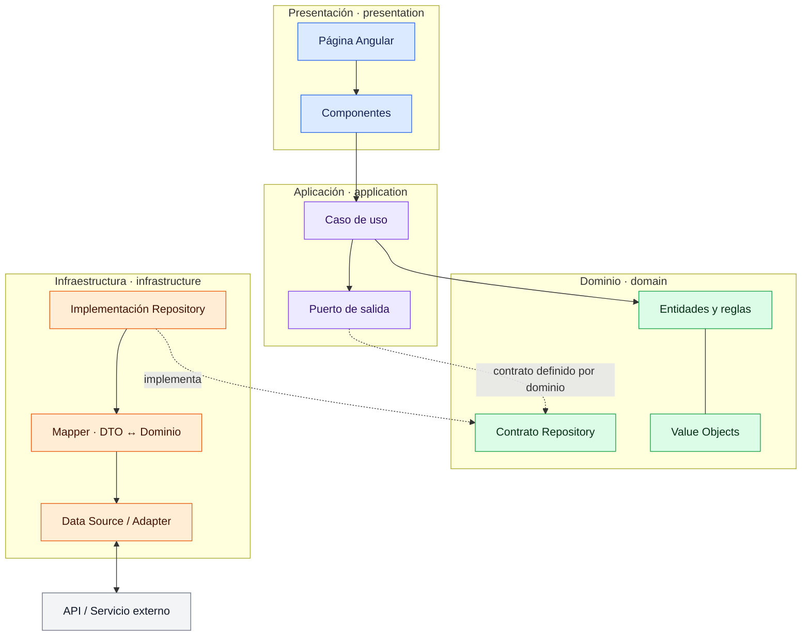
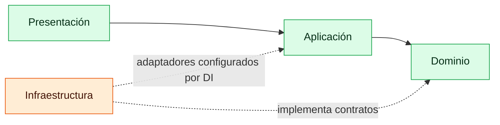
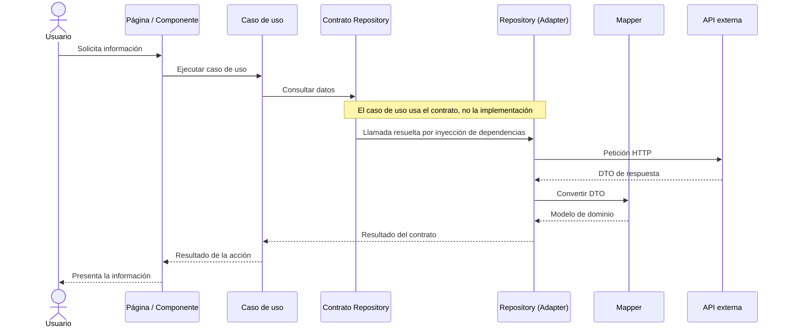

# Diseño gráfico de la arquitectura

Diagramas de referencia para organizar cada funcionalidad Angular según Clean
Architecture. Los ejemplos son conceptuales; no representan funcionalidades ya
implementadas.

## Vista por capas



### Dirección de dependencias

Las dependencias de código apuntan hacia las capas internas: presentación →
aplicación → dominio. Infraestructura conoce los contratos internos para
implementarlos; el dominio no importa Angular, HTTP ni infraestructura.



## Flujo de una consulta



## Dónde vive cada patrón

| Patrón | Responsabilidad | Ubicación |
|---|---|---|
| Use Case | Ejecuta una acción de negocio | `application/use-cases` |
| Repository | Define el contrato y oculta el origen de los datos | Contrato en `domain/repositories`; implementación en `infrastructure/repositories` |
| Adapter | Traduce llamadas de la aplicación a servicios externos | `infrastructure/data-sources` |
| Mapper | Convierte DTOs en modelos del dominio y viceversa | `infrastructure/mappers` |
| Dependency Injection | Conecta la abstracción con su implementación | Providers de Angular |

## Estructura de una funcionalidad

```text
features/<funcionalidad>/
├── domain/
│   ├── entities/
│   ├── repositories/
│   └── value-objects/
├── application/
│   ├── ports/
│   └── use-cases/
├── infrastructure/
│   ├── data-sources/
│   ├── dtos/
│   ├── mappers/
│   └── repositories/
└── presentation/
    ├── components/
    └── pages/
```

Usa solo las carpetas y patrones que requiera cada funcionalidad; el diagrama
describe límites de responsabilidad, no una obligación de crear clases vacías.
